<p align="center">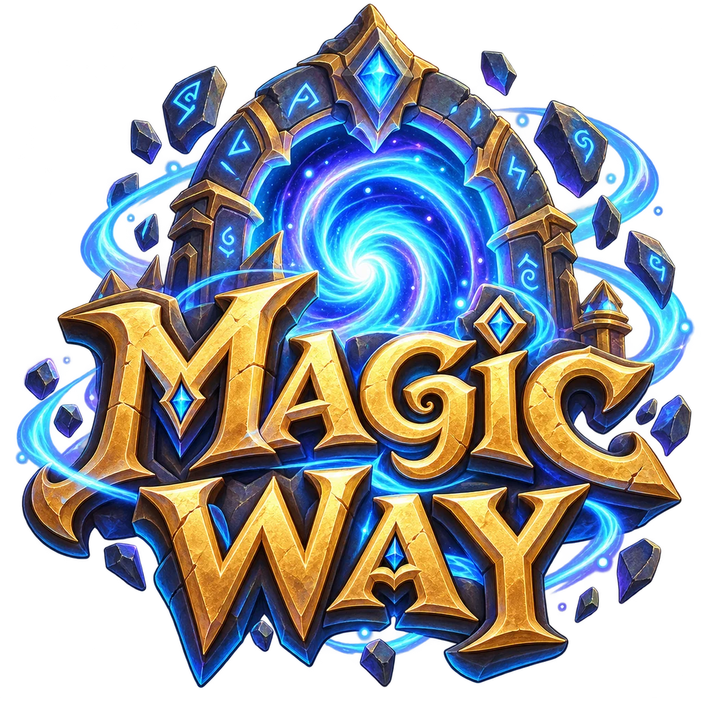</p>

<h3 align="center">Portales de teletransporte entre mapas para Foundry VTT 14</h3>

<p align="center">Áreas invisibles que dibujas arrastrando · tres modos de portal · un solo panel para el máster · cualquier sistema de juego</p>

<p align="center">
  <a href="https://github.com/morningstar3010/magic-way/releases"></a>
  
  <a href="https://github.com/morningstar3010/magic-way/releases"></a>
</p>

<p align="center">
  <a href="README.md" title="English"></a>
  <a href="README.it.md" title="Italiano"></a>
  <a href="README.de.md" title="Deutsch"></a>
  <a href="README.es.md" title="Español"></a>
  <a href="README.fr.md" title="Français"></a>
  <a href="README.pl.md" title="Polski"></a>
  <a href="README.pt-BR.md" title="Português (Brasil)"></a>
  <a href="README.ru.md" title="Русский"></a>
  <a href="README.cn.md" title="中文（简体）"></a>
  <a href="README.ja.md" title="日本語"></a>
  <a href="README.ko.md" title="한국어"></a>
</p>

<p align="center">
  🌐 <a href="README.md">English</a> · <a href="README.it.md">Italiano</a> · <a href="README.de.md">Deutsch</a> · <b>Español</b> · <a href="README.fr.md">Français</a> · <a href="README.pl.md">Polski</a> · <a href="README.pt-BR.md">Português (Brasil)</a> · <a href="README.ru.md">Русский</a> · <a href="README.cn.md">中文（简体）</a> · <a href="README.ja.md">日本語</a> · <a href="README.ko.md">한국어</a>
</p>

---

**Magic Way** lleva los tokens de un sitio a otro: dentro del mismo mapa o a otro mapa del mismo mundo. Dibujas una **entrada** y una **llegada** en el mapa, y cada token que pisa la entrada aparece en la llegada, con un destello mágico. Los jugadores nunca ven las áreas. Tú lo controlas todo desde un solo panel.

## Contenido

1. [Instalación](#install)
2. [Tu primer portal en un minuto](#quick-start)
3. [Abrir el panel](#open-panel)
4. [El panel de un vistazo](#panel)
5. [Crear un portal, paso a paso](#create)
6. [Usar y gestionar tus portales](#manage)
7. [Zonas: tus portales en orden](#zones)
8. [Búsqueda y filtros](#filters)
9. [Llevar mapas a otro mundo](#export)
10. [Ajustes e idioma](#settings)
11. [Preguntas y problemas](#faq)
12. [Macros](#macros)

<a name="install"></a>
## 1. Instalación

1. En Foundry, abre **Módulos complementarios** y pulsa **Instalar módulo**.
2. Abajo, en el campo **URL del manifiesto**, pega esta dirección y pulsa **Instalar**:

```
https://github.com/morningstar3010/magic-way/releases/latest/download/module.json
```

3. Abre tu mundo, ve a **Gestionar módulos**, marca **Magic Way** y guarda.

<a name="quick-start"></a>
## 2. Tu primer portal en un minuto

- [ ] Haz clic en el botón **Magic Way – Panel de portales** de la barra de herramientas de la izquierda.
- [ ] Pulsa **Nuevo portal** y escribe un nombre para la entrada y otro para la llegada.
- [ ] Pulsa **Siguiente: dibuja la entrada** y arrastra un rectángulo en el mapa.
- [ ] Quédate en esta escena o abre otra, y arrastra un rectángulo para la llegada.
- [ ] ¡Listo! Mueve un token de jugador a la entrada y míralo viajar.

> [!TIP]
> La llegada puede estar **en la misma escena** que la entrada o **en cualquier otra escena del mismo mundo**. Mientras dibujas, puedes cambiar de escena sin problema.

<a name="open-panel"></a>
## 3. Abrir el panel

<table><tr>
<td width="240">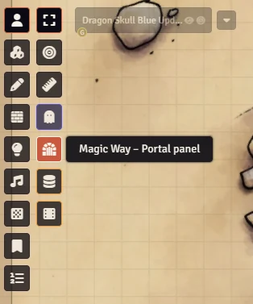</td>
<td>

El panel es solo para el máster. Puedes abrirlo de tres formas:

- con el **botón de la puerta** en la barra de herramientas de la izquierda (en el grupo Token o en el grupo Regiones);
- con la tecla que tú quieras, asignada en **Configurar controles**;
- desde una macro: `game.modules.get("magic-way").api.pannello()`.

</td>
</tr></table>

<a name="panel"></a>
## 4. El panel de un vistazo

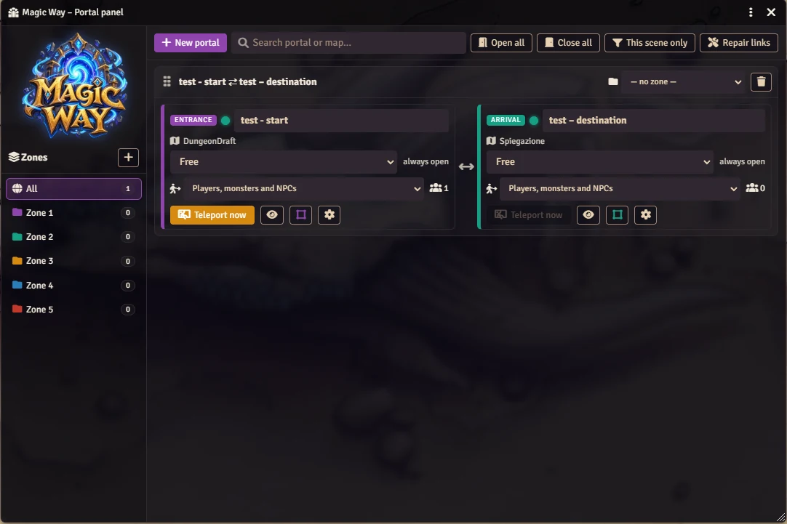

| Parte | Qué encuentras ahí |
|---|---|
| **Zonas** (columna izquierda) | Tus grupos de portales, como carpetas. **Todos** muestra todos los portales. |
| **Barra superior** | **Nuevo portal**, la casilla de **búsqueda**, **Abrir todos**, **Cerrar todos**, **Solo esta escena**, **Reparar enlaces**. |
| **Enlaces** (centro) | Cada enlace es una tarjeta: la **entrada** a la izquierda, la **llegada** a la derecha. Una doble flecha ⟷ significa que también puedes volver. |

En cada área ves el nombre de su mapa. **estás viendo esta** significa que está en la escena que estás mirando. **activa para los jugadores** significa que está en la escena donde están tus jugadores.

<a name="create"></a>
## 5. Crear un portal, paso a paso

### Paso 1 – Rellena el formulario

Pulsa **Nuevo portal** arriba en el panel.

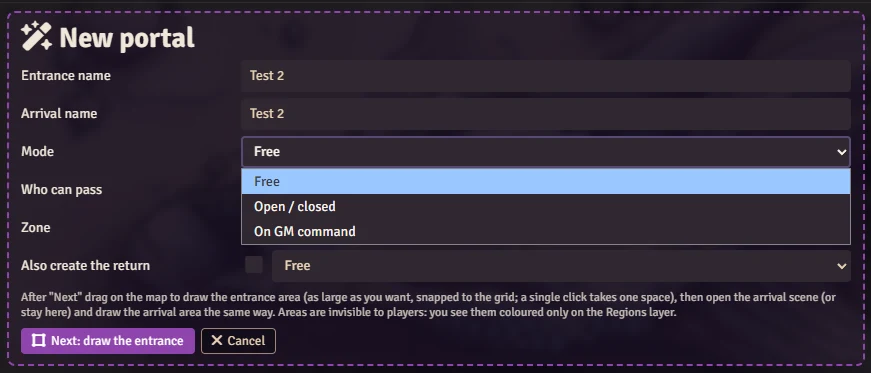

| Campo | Qué significa |
|---|---|
| **Nombre de la entrada** | El nombre del área que pisan los tokens (por ejemplo *Círculo mágico de la torre*). |
| **Nombre de la llegada** | El nombre del área donde aparecen los tokens (por ejemplo *Círculo mágico de la cripta*). |
| **Modo** | Cuándo funciona el portal: **Libre**, **Abierto / cerrado** o **A orden del máster**. Mira más abajo. |
| **Quién puede pasar** | Qué tokens viajan: los jugadores, los monstruos y PNJ del máster, o todos. |
| **Zona** | El grupo donde va el portal. Puedes cambiarlo más tarde. |
| **Crear también el regreso** | Márcalo para que la llegada funcione también como portal de vuelta a la entrada, con su propio modo. |

<details>
<summary><b>Los tres modos</b> (haz clic para abrir)</summary>

| Modo | Qué pasa cuando un token pisa la entrada |
|---|---|
| **Libre** | Se teletransporta enseguida. El portal siempre está abierto. |
| **Abierto / cerrado** | Solo viaja mientras mantengas el portal **Abierto**. Cuando está **Cerrado**, los tokens pasan por encima y no pasa nada. Lo abres y lo cierras desde el panel con un clic. |
| **A orden del máster** | No pasa nada por sí solo. Cuando estés listo, pulsas **Teletransportar ahora** y todos los que están dentro del área viajan juntos. |

</details>

<details>
<summary><b>Quién puede pasar</b> (haz clic para abrir)</summary>

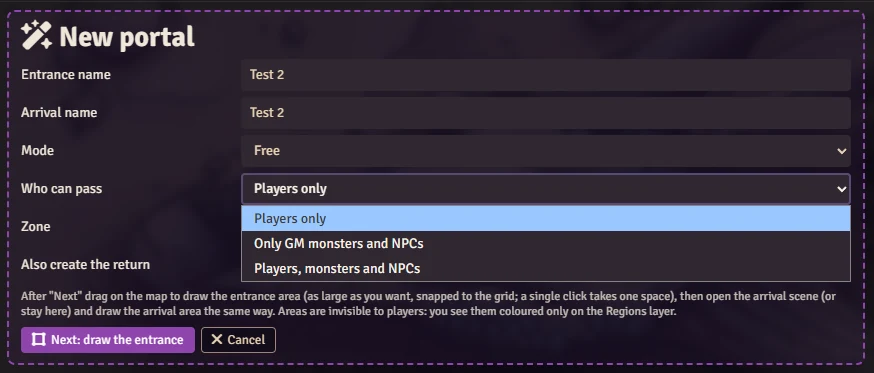

- **Solo jugadores**: solo los tokens que pertenecen a un jugador. Tus monstruos pueden pasar por encima del portal sin desaparecer.
- **Solo monstruos y PNJ del máster**: solo los tokens que no pertenecen a ningún jugador.
- **Jugadores, monstruos y PNJ**: todos.

Esta elección vale también para **Teletransportar ahora**.

</details>

<details>
<summary><b>El regreso</b> (haz clic para abrir)</summary>

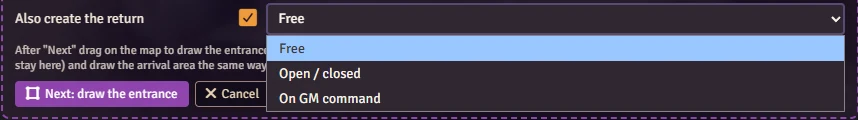

Con el regreso marcado, la llegada se convierte también en un portal de vuelta a la entrada. El menú junto a la casilla fija el modo del regreso, que puede ser distinto del de la ida. ¿Se te olvidó marcarlo? No pasa nada: la tarjeta de la llegada tiene un botón **Crear el regreso**.

</details>

### Paso 2 – Dibuja la entrada

Pulsa **Siguiente: dibuja la entrada** y luego **arrastra en el mapa**. El rectángulo se ajusta a la cuadrícula y puede ser tan grande como quieras. La barra de arriba muestra su tamaño en casillas y en metros. Un solo clic toma una sola casilla. **Esc** o un **clic derecho** cancela.

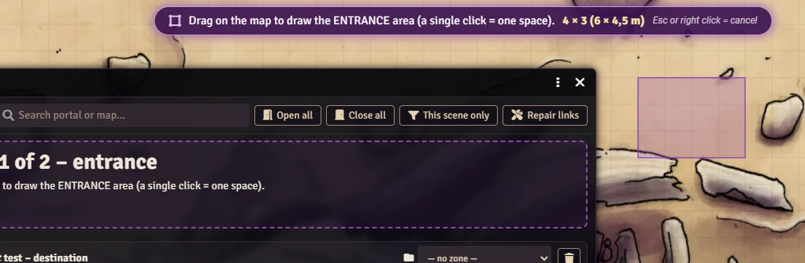

### Paso 3 – Dibuja la llegada

Ahora **quédate en esta escena o abre otra escena del mismo mundo**, y arrastra el área de llegada de la misma forma.

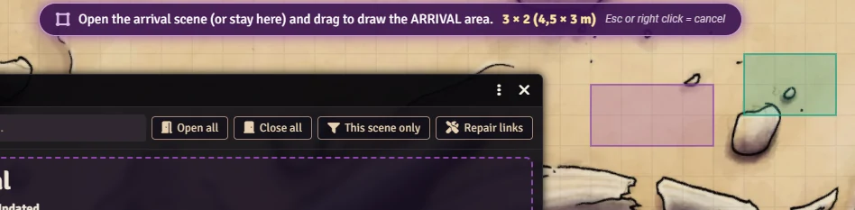

### Paso 4 – ¡Listo!

<table><tr>
<td width="320">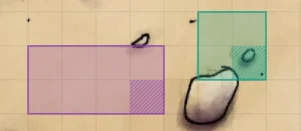</td>
<td>

La **entrada es morada**, la **llegada es verde**. Solo las ves cuando la capa de **Regiones** está activa. **Los jugadores nunca las ven.**

También puedes cambiarles la forma con las herramientas normales de Regiones de Foundry, por ejemplo para darle a un área forma de polígono.

</td>
</tr></table>

> [!WARNING]
> En la configuración de la región, **no marques «Oculta» («Hidden»)**. Las áreas ya son invisibles para los jugadores, y en Foundry 14 «Oculta» apaga todo lo que hay dentro del área, así que el portal deja de funcionar. Si la marcas sin querer, Magic Way te avisa y el panel marca el portal como **desactivado**.

<a name="manage"></a>
## 6. Usar y gestionar tus portales

Cada área donde empieza un viaje tiene sus propios controles:

- el campo **nombre**: haz clic y escribe para cambiar el nombre del área;
- el menú **modo** y, en el modo Abierto / cerrado, el interruptor **Abierto / Cerrado**;
- el menú **quién puede pasar**;
- el número de tokens **dentro del área** (pasa el ratón por encima para ver sus nombres).

Abajo, en cada área, hay una fila de botones:

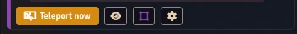

| Botón | Qué hace |
|---|---|
| **Teletransportar ahora** | Manda a todos los que están dentro del área a la llegada, al momento, en cualquier modo. Se ilumina cuando hay alguien dentro. |
| 👁 **ojo** | **Mostrar esta área en el mapa**: abre su escena, cambia a la capa de Regiones y señala el área. |
| ▢ **cuadrado** | **Volver a dibujar esta área**: arrastra un rectángulo nuevo, incluso en otra escena. |
| ⚙ **engranaje** | **Configuración de la región**: la ventana normal de Foundry para la región. |

Una llegada sin camino de vuelta muestra **Crear el regreso**: un clic y puedes viajar en los dos sentidos.

### Eliminar un enlace

Pulsa la **papelera roja** arriba a la derecha de la tarjeta y confirma.

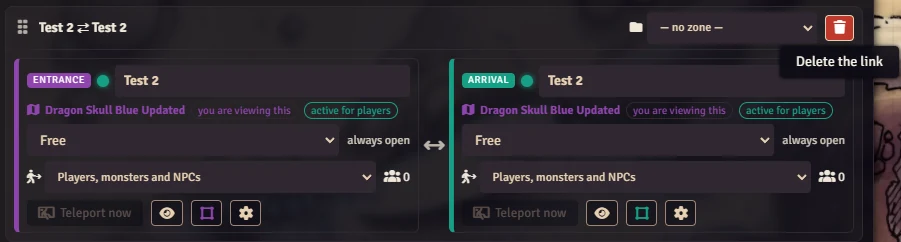

El enlace desaparece **junto con sus áreas en el mapa**: no tienes que borrar nada a mano. Un área solo se conserva si otro enlace todavía la usa, o si contiene comportamientos añadidos por otros módulos.

<a name="zones"></a>
## 7. Zonas: tus portales en orden

Las zonas son como carpetas: por ejemplo *Torre del mago*, *Mazmorra nivel 1*, *Ciudad*.

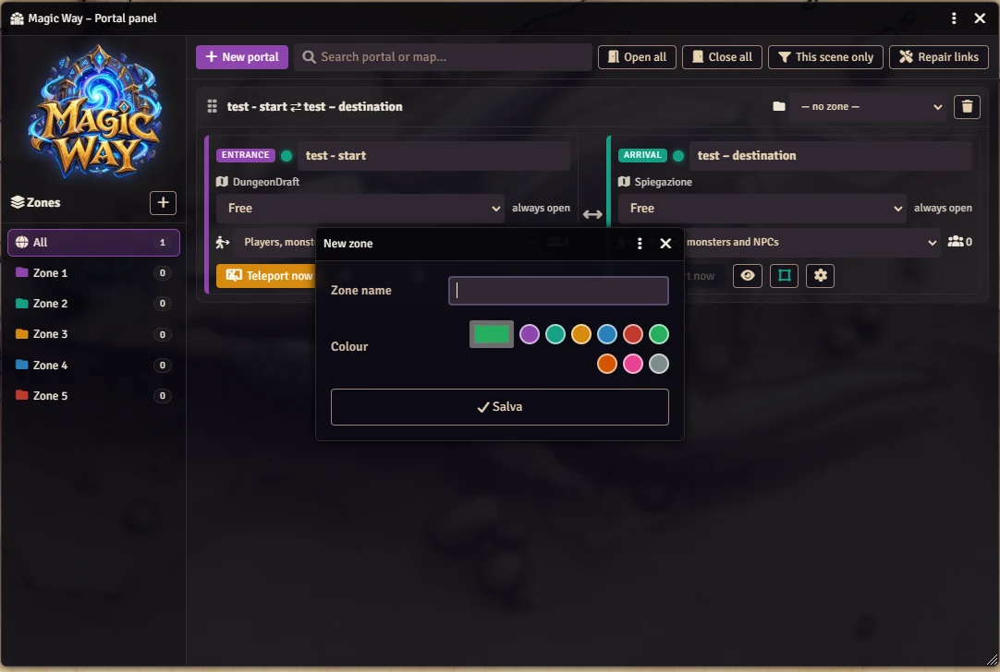

- **Crear una zona**: pulsa **+** arriba en la columna Zonas. Elige un **nombre**, un **color** (uno de los colores listos o el que tú quieras) y, si quieres, la zona **dentro** de la que va.
- **Subzonas**: las zonas pueden ir dentro de otras zonas, tan hondo como quieras. Siempre están en **orden alfabético**.
- **Filtro**: haz clic en una zona para ver solo sus portales, también los de sus subzonas. El número de al lado los cuenta todos.
- **Color**: lo ves en el icono de la carpeta y en el borde de las tarjetas de sus portales.
- **Pasa el ratón por encima de una zona** para ver tres botones: **+** crea una subzona dentro, el **lápiz** cambia nombre, color y zona superior, la **papelera** la elimina (sus portales y subzonas suben un nivel).

**Arrastrar y soltar** hace el resto:

| Arrastra… | …y suéltalo sobre | Resultado |
|---|---|---|
| una tarjeta de portal (agárrala por su barra de título) | una zona | el portal va justo a esa zona, aunque sea una subzona |
| una tarjeta de portal | **Todos** | el portal ya no tiene zona |
| una zona | otra zona | se convierte en subzona de esa zona |
| una zona | **Todos** | vuelve al nivel superior |

El **candado** junto al **+** en la parte superior de la columna de zonas bloquea y desbloquea mover las zonas arrastrándolas. Cuando está cerrado, las zonas se quedan donde están, pero puedes seguir arrastrando portales a ellas.

Si una zona se pone **roja** mientras arrastras, significa «no permitido»: una zona no puede ir dentro de sí misma ni dentro de una de sus propias subzonas.

También puedes elegir la zona de un portal en el menú con el icono de la carpeta, arriba en su tarjeta.

<a name="filters"></a>
## 8. Búsqueda y filtros

- **Buscar portal o mapa…**: escribe parte del nombre de un portal **o de un mapa**. Las mayúsculas y los acentos no importan. Las tarjetas que no coinciden desaparecen, y también las zonas que se quedan vacías.
- 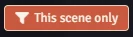 **Solo esta escena**: muestra solo los enlaces que tienen un área en la escena que estás mirando. Púlsalo otra vez para verlos todos.
- **Abrir todos** y **Cerrar todos**: abren o cierran de una vez todos los portales **Abierto / cerrado** que ves en la lista.

<a name="export"></a>
## 9. Llevar mapas a otro mundo

Los portales viajan **dentro de sus mapas**. Exporta una escena (a un compendio, una Aventura o un archivo JSON), impórtala en otro mundo u otro servidor donde Magic Way esté activo, y las áreas y los portales van con ella.

Las escenas importadas reciben IDs nuevos, pero cada área tiene su propio código y cada portal recuerda dónde está su llegada. Magic Way **repara los enlaces solo** cuando arranca el mundo y después de cada importación. También puedes pulsar tú **Reparar enlaces**. Las zonas que faltan se vuelven a crear con su nombre, su color y sus zonas superiores.

Si importas solo uno de los dos mapas de un enlace, el portal muestra un **aviso rojo** con el nombre del mapa que falta. Impórtalo también y el enlace se arregla solo. Un mapa duplicado en el mismo mundo también funciona.

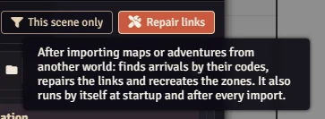

<a name="settings"></a>
## 10. Ajustes e idioma

Abre **Configurar ajustes → Magic Way**.

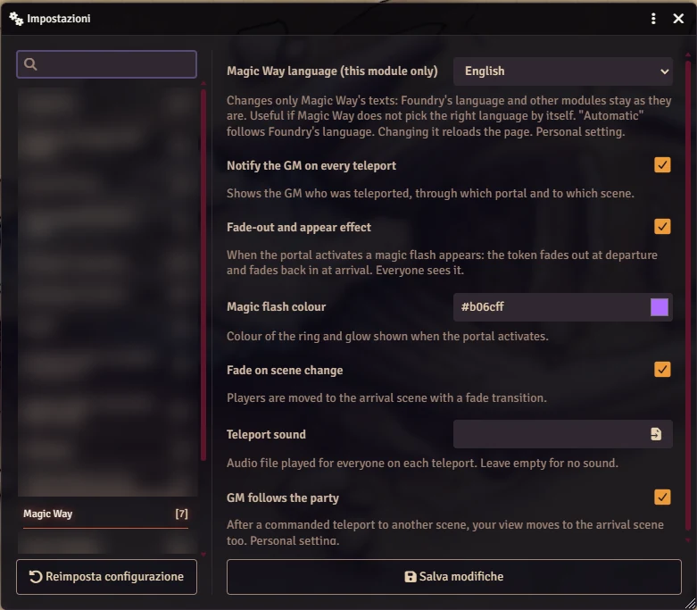

| Ajuste | Qué hace |
|---|---|
| **Idioma de Magic Way (solo este módulo)** | Elige el idioma solo de Magic Way: Foundry y los demás módulos se quedan como están. **Automático** sigue a Foundry. Ajuste personal; la página se recarga. |
| **Avisar al máster en cada teletransporte** | Un mensaje te dice quién ha viajado, por qué portal y a qué escena. |
| **Efecto de desvanecimiento y aparición** | El destello mágico: el token se desvanece al partir y reaparece con un fundido al llegar. Lo ven todos los que miran la escena. |
| **Color del destello mágico** | El color del anillo y del resplandor. |
| **Fundido al cambiar de escena** | Los jugadores que pasan a otra escena ven una transición con fundido. |
| **Sonido del teletransporte** | Un archivo de audio que suena para todos en cada viaje. Déjalo vacío si no quieres sonido. |
| **El máster sigue al grupo** | Tras un viaje a tu orden hacia otra escena, tu vista también pasa allí. Ajuste personal. |

Idiomas disponibles: English, Italiano, Deutsch, Español, Français, Polski, Português (Brasil), Русский, 中文（简体）, 日本語, 한국어.

<a name="faq"></a>
## 11. Preguntas y problemas

<details>
<summary><b>Un token entra en la entrada y no pasa nada</b></summary>

Revisa estos puntos, en orden:

1. **Modo**: un portal **Abierto / cerrado** tiene que estar **Abierto**; un portal **A orden del máster** espera a **Teletransportar ahora**.
2. **Quién puede pasar**: con **Solo jugadores**, tus monstruos pasan por encima sin viajar.
3. **Tiene que haber un máster conectado**: solo el máster puede crear y quitar tokens en las escenas.
4. El panel no debe decir **desactivado**: en la configuración de la región, «Oculta» («Hidden») tiene que estar sin marcar.

</details>

<details>
<summary><b>¿Mis jugadores pueden ver las áreas?</b></summary>

No. Las áreas solo las ve el máster, y solo en la capa de Regiones.

</details>

<details>
<summary><b>¿Qué pasa cuando la llegada está en otra escena?</b></summary>

El token se vuelve a crear en la escena de llegada con el mismo actor y los mismos ajustes, y después se quita de la escena de salida. Sus dueños pasan a la nueva escena y su vista se centra en su token. El destello mágico espera un momento, para que los jugadores tengan tiempo de cargar el mapa.

</details>

<details>
<summary><b>Llegan varios tokens a la vez: ¿se amontonan?</b></summary>

No. Ocupan las casillas libres del área de llegada, empezando por el centro. Si no hay bastantes, se colocan alrededor.

</details>

<details>
<summary><b>¿Funcionan las escenas con varios niveles?</b></summary>

Sí. El token llega al nivel del área de llegada.

</details>

<details>
<summary><b>¿Puedo convertir en portal una región que dibujé yo?</b></summary>

Sí. En la configuración de la región, añade el comportamiento **Magic Way – Portal** y elige su área de llegada. El panel la encuentra solo.

</details>

<a name="macros"></a>
## 12. Macros

<details>
<summary><b>Comandos para macros y otros módulos</b> (haz clic para abrir)</summary>

`"Nombre"` es el nombre del portal (su UUID también vale).

```js
const mw = game.modules.get("magic-way").api;
mw.pannello();                       // abre el panel
mw.apri("Nombre");                   // abre un portal Abierto / cerrado
mw.chiudi("Nombre");                 // lo cierra
mw.alterna("Nombre");                // lo abre si está cerrado, lo cierra si está abierto
mw.modalita("Nombre", "comando");    // modo: "libero" (libre) | "controllato" (abierto/cerrado) | "comando" (a orden)
mw.passano("Nombre", "tutti");       // quién pasa: "giocatori" (jugadores) | "png" (monstruos y PNJ) | "tutti" (todos)
mw.teletrasporta("Nombre");          // teletransporta ahora a todos los que están dentro del área
mw.teletrasportaToken("Nombre", canvas.tokens.controlled); // teletransporta los tokens seleccionados
mw.ripara();                         // repara los enlaces después de una importación
```

Después de cada viaje, el módulo lanza el hook `magic-way.teletrasporto` con `{portale, destinazione, tokens}`.

</details>

---

<p align="center">Creado por <b>MorningStar</b></p>
